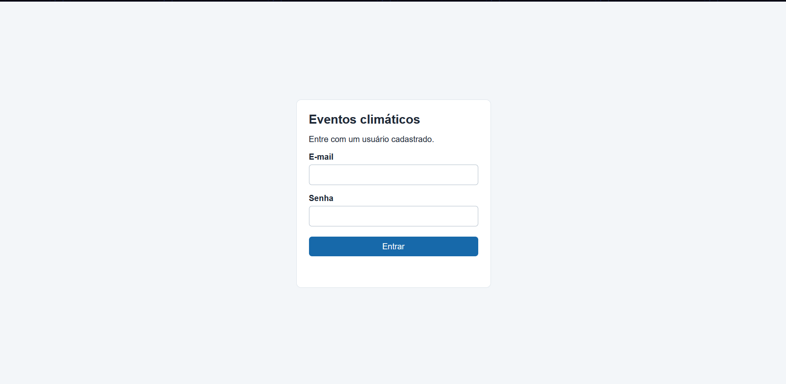
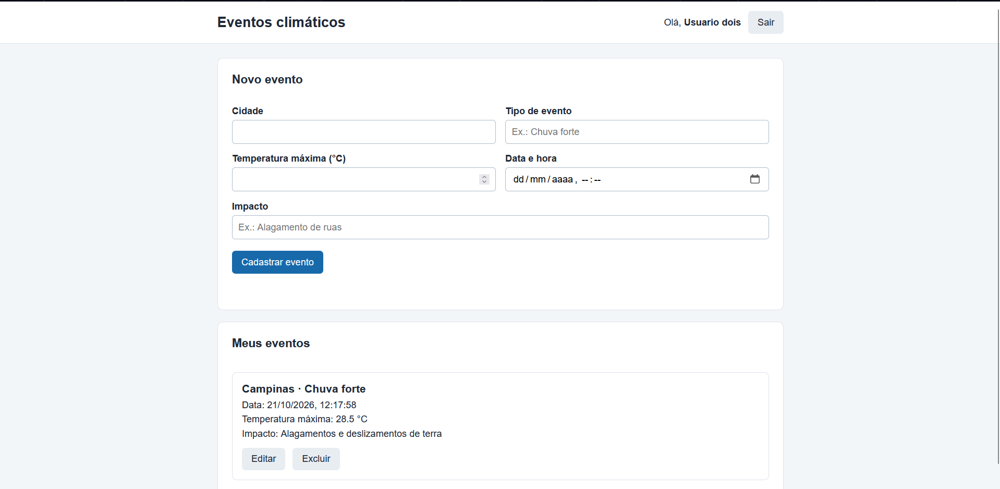

# Eventos Climáticos

Aplicação web para registrar e acompanhar eventos climáticos por usuário. É possível informar cidade, tipo do evento, temperatura máxima, data e impactos.

## Estrutura do projeto

- `web/`: páginas de login e eventos, scripts e estilos da interface.
- `api/`: servidor Node.js com Express, rotas, controladores e acesso ao banco via Prisma.
- `api/prisma/`: esquema, migrações e dados de exemplo.
- `assets/`: imagens do projeto.
- `docs/`: diagrama do banco (`DER.png`) e coleção de requisições do Insomnia.

## Screenshots




## Tecnologias

- HTML, CSS e JavaScript
- Vs Code
- Node.js e Express
- Prisma
- MySQL ou MariaDB

## Como executar

1. Instale o Node.js e prepare um banco MySQL/MariaDB.
2. No terminal, entre na pasta `api` e instale as dependências:

   ```bash
   cd api
   npm install
   ```

3. Crie o arquivo `api/.env` com a conexão do banco:

   ```env
   PORT=3000
   DATABASE_URL="mysql://root@localhost:3306/eventos"
   ```

   Troque `USUARIO` e `SENHA` pelos dados do seu banco e crie nele o banco `eventos_climaticos`.

4. Execute as migrações e gere o cliente Prisma:

   ```bash
   npx prisma migrate deploy
   npx prisma generate
   ```

5. Inicie a aplicação:

   ```bash
   npm run dev
   ```

6. Acesse [http://localhost:3000](http://localhost:3000).

O servidor também disponibiliza os arquivos da interface. Para entrar, use um usuário existente. A rota de cadastro está disponível na API; não há formulário de cadastro na interface.

### Dados de exemplo

Para criar usuários e eventos de exemplo, execute na pasta `api`:

```bash
npx prisma db seed
```

Os usuários de exemplo usam a senha `senha123`. **Atenção:** o seed apaga os usuários e eventos existentes antes de criar os dados de exemplo.

## Rotas da API

Todas as rotas usam a base `http://localhost:3000`.

| Método | Rota | Descrição |
|---|---|---|
| `POST` | `/usuarios/cadastrar` | Cadastra um usuário |
| `POST` | `/usuarios/login` | Faz login |
| `GET` | `/usuarios/listar` | Lista usuários |
| `PUT` | `/usuarios/atualizar/:id` | Atualiza um usuário |
| `DELETE` | `/usuarios/excluir/:id` | Exclui um usuário |
| `POST` | `/eventos/cadastrar` | Cadastra um evento |
| `GET` | `/eventos/listar` | Lista eventos; aceita `?usuarioId=ID` para filtrar por usuário |
| `PUT` | `/eventos/atualizar/:id` | Atualiza um evento |
| `DELETE` | `/eventos/excluir/:id` | Exclui um evento |

As requisições de criação e atualização recebem dados JSON. A coleção do Insomnia em `docs/` pode ser usada para testar as rotas.

> O login e o armazenamento de senhas são simples e voltados a fins de estudo; antes de usar em produção, implemente armazenamento seguro de senhas e autenticação apropriada.
